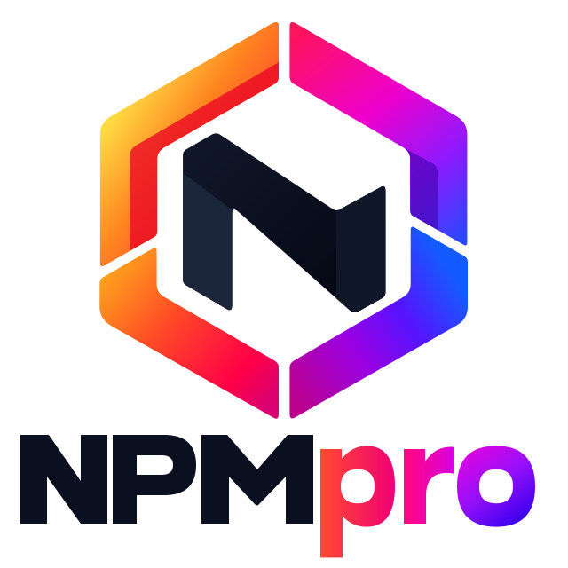
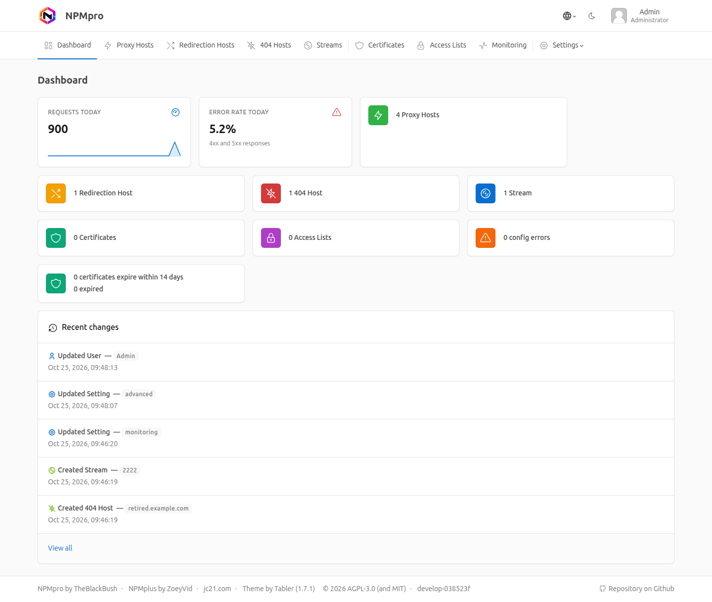

<p align="center">
  <picture>
    <source media="(prefers-color-scheme: dark)" srcset=".github/images/brand/npmpro-stacked-dark.svg">
    
  </picture>
</p>

<p align="center">
  <a href="https://github.com/TheBlackBush/NPMpro/actions/workflows/docker.yml"></a>
  <a href="https://github.com/TheBlackBush/NPMpro/actions/workflows/test.yml"></a>
  <a href="COPYING"></a>
  <a href="https://github.com/TheBlackBush/NPMpro/pkgs/container/npmpro"></a>
  <a href="https://github.com/TheBlackBush/NPMpro/pkgs/container/npmpro"></a>
  <a href="https://hub.docker.com/r/blackbush/npmpro"></a>
  
  <a href="https://ko-fi.com/M4M11W3R7J"></a>
</p>

NPMpro is a reverse proxy with a web UI: you add your domains, point them at your services and get HTTPS certificates, without writing nginx configs.
It is a hardened fork of nginx-proxy-manager (see [Credits](#credits)) and ships as one Docker image with a custom-compiled nginx (HTTP/3, brotli/zstd, lua, njs, ECH), a Node.js backend and a React web UI.



Images: `ghcr.io/theblackbush/npmpro` and `blackbush/npmpro` (tags: `latest`, `develop` and version tags like `1.0.0`). Documentation beyond this README is in the [wiki](https://github.com/TheBlackBush/NPMpro/wiki). If you do not need a web UI, have a look at [caddy](https://caddyserver.com).

- **License:** GNU Affero General Public License version 3 or any later version, based on the MIT licensed [nginx-proxy-manager](https://github.com/NginxProxyManager/nginx-proxy-manager).
- **Certificates:** by running NPMpro you agree to the ToS of Let's Encrypt or your custom CA.
- **HTTP/3:** expose the https port over udp too (443/udp).
- **HSTS:** add your domain to the [HSTS preload list](https://hstspreload.org) if you enabled HSTS for it.
- **Issues:** please report them at https://github.com/TheBlackBush/NPMpro/issues.

## Contents

- [Features](#features)
- [Quick start](#quick-start)
- [Settings and environment variables](#settings-and-environment-variables)
- [Upgrade notes](#upgrade-notes)
- [Upgrading from NPMplus](#upgrading-from-npmplus)
- [Migration from nginx-proxy-manager](#migration-from-nginx-proxy-manager)
- [Compatibility (to Upstream)](#compatibility-to-upstream)
- [Crowdsec](#crowdsec)
- [PHP](#use-of-external-php-fpm-recommended)
- [OIDC login](#oidc-login)
- [Monitoring](#monitoring)
- [GoAccess](#goaccess)
- [Backup and restore](#backup-and-restore)
- [Database](#database)
- [Comments on some buttons](#comments-on-some-buttons)
- [Forward authentication (auth_request) examples](#examples-of-implementing-some-services-using-auth_request)
- [Load Balancing](#load-balancing)
- [Encrypted Client Hello (ECH)](#encrypted-client-hello-ech)
- [Geoblocking](#geoblocking-example-mainly-community-support)
- [Prerun scripts](#prerun-scripts-expert-option---if-you-dont-know-what-this-is-ignore-it)
- [Notes on Cloudflare](#notes-on-cloudflare)
- [Hints for Your Privacy Policy](#hints-for-your-privacy-policy)
- [Connections from the container](#what-connections-can-be-expected-from-the-npmpro-container)
- [Access Lists](#access-lists)
- [Contributing](#contributing), [Getting Help](#getting-help), [Credits](#credits)

## Features

### Proxy and hosts
- Proxy hosts, redirection hosts, 404 hosts and streams (TCP/UDP), managed in the web UI
- HTTP/3 (QUIC), needs the https port exposed over udp
- more ways to serve a host: gRPC, proxy protocol, load balancing over several upstreams (see [Load Balancing](#load-balancing)), and serving files or PHP directly with fancyindex support
- zstd and brotli compression in addition to gzip
- punycode domain support
- host configs that are missing on startup are regenerated, even when no variable or template changed

### TLS and certificates
- hardened TLS by default: patched nginx built with aws-lc compiled from source, enforced cipher and curve order, certificate compression (zlib-ng and brotli), optional encrypted client hello ([ECH](#encrypted-client-hello-ech))
- short-lived Let's Encrypt certificates by default, plus proper support for other ACME servers (ZeroSSL, Google Public CA, your own) with OCSP stapling and Must-Staple
- DNS challenge with many providers and saved DNS credentials: enter the credentials of a DNS provider once (Certificates, DNS credentials tab) and reuse them; they are stored encrypted with the key `/data/npmpro/dns-credentials.key`. The same key also encrypts the OIDC client secret, the MaxMind license key and the key behind the unique visitor hashes: keep it with your backups (without it saved DNS credentials, the client secret and the license key must be entered again)
- custom certificates can be replaced, and mTLS with client certificates per host

### Security
- [CrowdSec](#crowdsec) support, including AppSec (WAF) and bot detection
- security headers always sent, fingerprinting headers stripped, based on the OWASP secure headers project
- several access lists per host and per location
- a hardened web UI: https, strict CSP, an httpOnly cookie instead of local storage, rate limits and more
- opt-in logging: no log files on disk unless you turn them on

### Authentication
- [OIDC sign-in](#oidc-login) for the web UI, with automatic account creation on the first sign-in (optional, limited to allowed email domains), a custom sign-in button and an option to turn off password sign-in
- built-in forward authentication (auth_request) for Anubis, Tinyauth, OAuth2 Proxy, VoidAuth, Authelia and Authentik, no advanced config needed (see [the examples](#examples-of-implementing-some-services-using-auth_request))
- two-factor authentication (TOTP) for users, password and MFA reset from the command line (SQLite only): `docker exec -it npmpro password-reset.js USER_EMAIL [--disable-mfa]`, the new password is read from stdin

### Monitoring and logs
- a [Monitoring](#monitoring) page with traffic statistics per host (requests, bytes, status classes, countries, networks, optional unique visitors and top IPs) and the active CrowdSec bans
- GeoIP: NPMpro downloads the MaxMind GeoLite2 databases itself (Settings, GeoIP)
- the [GoAccess](#goaccess) log report (`/goaccess`) and a Swagger UI (`/api/docs`) for the API, both inside the web UI

### Web UI and operations
- most settings live in the web UI (Settings): certificates and TLS, network, forward authentication, logs and monitoring, GeoIP, authentication, nginx core options (workers, TLS 1.2, curves, modules) and more; an environment variable still wins and locks the field (see [Settings and environment variables](#settings-and-environment-variables))
- an Environment page (Settings, Environment) that lists the startup variables read-only, secrets never shown
- audit log, users with per-section permissions, light and dark theme
- database backup before upgrades (SQLite only): before database migrations run, the database is copied to `/data/backups/database` (the newest 5 are kept; a copy holds the secrets the database held at that time, so treat the folder like the database). To go back to the previous image, stop the container, replace `/data/npmpro/database.sqlite` with the backup (remove `database.sqlite-wal` and `database.sqlite-shm` next to it) and start the previous image
- Alpine based, a much smaller image
- many other things, see this README and the [compose.yaml](compose.yaml)

## Quick start
1. Install Docker and Docker Compose (podman or rootless docker may also work)
   - [Docker Install documentation](https://docs.docker.com/engine/install)
   - [Docker Compose Install documentation](https://docs.docker.com/compose/install/linux)
2. Download this [compose.yaml](https://raw.githubusercontent.com/TheBlackBush/NPMpro/refs/heads/develop/compose.yaml) (or use its content as a portainer stack)
3. Set `TZ` to your time zone. Set there, it wins over the Time zone setting (Settings, Advanced), which then shows "Set by TZ". To choose the time zone in the web UI instead (default UTC), comment `TZ` out and keep at least one other active variable (compose refuses an empty `environment:` list) or remove the `environment:` key. Most other options can be set later in the web UI.
4. Start NPMpro (or deploy your portainer stack):
```bash
docker compose up -d
```
5. Open the web UI with `https://` on port `81` (for example `https://192.168.1.10:81`) and create your admin account. The certificate of the web UI is a generated placeholder until you choose a default certificate (Settings, Certificates & TLS).

More detail (requirements, first steps, reverse proxying the web UI itself) is in the wiki: [Installation](https://github.com/TheBlackBush/NPMpro/wiki/Installation) and [Usage](https://github.com/TheBlackBush/NPMpro/wiki/Usage).

## Settings and environment variables

Most settings live in the web UI under Settings, and that is the normal place to change them. Every one of them can also be set with an environment variable in your `compose.yaml`:

- **A variable wins and locks the field.** The field shows the value of the variable and cannot be changed in the UI. Its badge names the variable: "Set by ACME_KEY_TYPE". A field that another variable forces gets its own badge with the reason: "Follows ACME_KEY_SIZE" (`ACME_KEY_SIZE` set alone is an ECDSA curve, so the key type stays ECDSA; an RSA size only works together with `ACME_KEY_TYPE=rsa`), "Off because of ACME_OCSP_STAPLING" (Must-Staple needs OCSP stapling), "Required by ACME_MUST_STAPLE" (OCSP stapling stays on) and "Required by GOA" (GoAccess reads the log files, so Write log files stays on; "Required by the GoAccess report" when the setting turned GoAccess on). The Authentication, traffic statistics and GeoIP fields show "Set by environment".
- **Remove the variable to manage the field in the UI again.** Changing or removing a variable needs the container to be recreated (`docker compose up -d`), like any change in `compose.yaml`.
- **The Environment page** (Settings, Environment) lists the startup variables (ports, bindings, PUID/PGID, `NGINX_QUIC_BPF` and PHP, database, first start, ACME account) with their value or default, among them `TZ`, `GOA` and `GOACLA`, which are also settings, and every setting that a variable locks. Values of passwords, email addresses and keys are never shown, only whether they are set.
- **"Restart required" settings** (Time zone, GoAccess report and the GoAccess options) are read when the container starts. Saving them stores the value; the section then shows "Restart the container to apply" with the fields until you restart the container (`docker restart npmpro`).
- Variables that are only read at startup and have no field (ports, bindings, `PUID`/`PGID`, `DISABLE_HTTP`, `NGINX_QUIC_BPF`, PHP, database, `ACME_SERVER`, `ACME_EMAIL` and the EAB keys, `INITIAL_*`) stay in `compose.yaml`; the [compose.yaml](compose.yaml) lists every supported variable with its default.

When a saved setting applies:

| Settings page | Field | Variable | Applies |
|---|---|---|---|
| Certificates & TLS | Key type | `ACME_KEY_TYPE` | to the next certificate |
| Certificates & TLS | Key size | `ACME_KEY_SIZE` | to the next certificate |
| Certificates & TLS | ACME profile | `ACME_PROFILE` | to the next certificate (checked with the ACME server when you save) |
| Certificates & TLS | OCSP Must-Staple | `ACME_MUST_STAPLE` | to the next certificate |
| Certificates & TLS | Verify the ACME server certificate | `ACME_SERVER_TLS_VERIFY` | to the next certificate |
| Certificates & TLS | Renewal check interval | `CERTBOT_RUN_INTERVAL` | immediately |
| Certificates & TLS | OCSP stapling for ACME certificates | `ACME_OCSP_STAPLING` | on save, with an nginx reload |
| Certificates & TLS | OCSP stapling for custom certificates | `CUSTOM_OCSP_STAPLING` | on save, with an nginx reload |
| Certificates & TLS | Default certificate: Certificate for unknown hosts and the web UI | `DEFAULT_CERT_ID` | on save, with an nginx reload |
| Certificates & TLS | ECH key rotation interval | `ECH_ROTATION_INTERVAL` | immediately |
| Network | Trusted proxy IPs | `TRUST_IP` | on save, with an nginx reload |
| Network | Trust Cloudflare | `TRUST_CLOUDFLARE` | on save, with an nginx reload |
| Forward authentication | Anubis, Tinyauth, OAuth2 Proxy, VoidAuth, Authelia and Authentik upstream | `AUTH_REQUEST_<PROVIDER>_UPSTREAM` (`ANUBIS`, `TINYAUTH`, `OAUTH2PROXY`, `VOIDAUTH`, `AUTHELIA`, `AUTHENTIK`) | on save, with an nginx reload |
| Forward authentication | Custom Anubis images | `AUTH_REQUEST_ANUBIS_USE_CUSTOM_IMAGES` | on save, with an nginx reload |
| Logs & monitoring | Write log files | `LOGROTATE` | on save, with an nginx reload |
| Logs & monitoring | Log rotations kept | `LOGROTATIONS` | immediately |
| Logs & monitoring | GoAccess report | `GOA` | after a restart |
| Logs & monitoring | GoAccess options (keep report data, anonymize visitor IPs, drop query strings, full operating system versions, resolve host names) | `GOACLA` (one variable for all of them) | after a restart |
| Logs & monitoring | Traffic statistics, keep statistics for, show visitor IPs, count unique visitors, visitor limit per host and day | `TRAFFIC_STATS`, `TRAFFIC_RETENTION_DAYS`, `TRAFFIC_SHOW_IPS`, `TRAFFIC_UNIQUE_VISITORS`, `TRAFFIC_VISITORS_CAP` | on save |
| GeoIP | Account ID, license key, databases | `GEOIP_ACCOUNT_ID`, `GEOIP_LICENSE_KEY`, `GEOIP_EDITIONS` | on save (the download starts) |
| Authentication | Issuer URL, client ID, client secret, redirect domain, require a verified email, disable password login, skip two-factor after OIDC | `OIDC_ISSUER_URL`, `OIDC_CLIENT_ID`, `OIDC_CLIENT_SECRET`, `OIDC_REDIRECT_DOMAIN`, `OIDC_REQUIRE_VERIFIED_EMAIL`, `OIDC_DISABLE_PASSWORD`, `OIDC_SKIP_MFA` | on save |
| nginx | Worker processes, worker connections, worker shutdown timeout | `NGINX_WORKER_PROCESSES`, `NGINX_WORKER_CONNECTIONS`, `NGINX_WORKER_SHUTDOWN_TIMEOUT` | on save, with an nginx reload |
| nginx | Log requests for missing files | `NGINX_LOG_NOT_FOUND` | on save, with an nginx reload |
| nginx | TLS 1.2, NIST P curves (secp521r1, secp384r1, secp256r1), RSA PKCS#1 signature algorithms | `NGINX_DISABLE_TLS12` (inverted), `NGINX_TRUST_SECPR1`, `NGINX_TRUST_RSA_PKCS1` | on save, with an nginx reload |
| nginx | Post-quantum only (X25519MLKEM768): turns TLS 1.2 and the NIST P curves off and locks them | `NGINX_FORCE_X25519MLKEM768` | on save, with an nginx reload |
| nginx | Modules: njs, LDAP, NTLM, virtual host traffic status | `NGINX_LOAD_NJS_MODULE`, `NGINX_LOAD_LDAP_MODULE`, `NGINX_LOAD_NTLM_MODULE`, `NGINX_LOAD_VHOST_TRAFFIC_STATUS_MODULE` | on save, with an nginx reload |
| Advanced | Format nginx configs | `DISABLE_NGINX_BEAUTIFIER` (inverted) | immediately |
| Advanced | Gravatar profile pictures | `DISABLE_GRAVATAR` (inverted) | immediately (a user's picture changes at their next profile save) |
| Advanced | Time zone | `TZ` | after a restart |

Turning on post-quantum only (by `NGINX_FORCE_X25519MLKEM768` or in Settings) overrides `NGINX_DISABLE_TLS12` and `NGINX_TRUST_SECPR1`; the stored TLS 1.2 and P curve settings are not changed.

Changes that need an nginx reload are tested with `nginx -t` first: if the test fails, nothing is saved, the previous files are kept and the nginx message is shown.

## Upgrade notes

For installs that update to this version:

- **One full regeneration of the host configs** on the first start (the template version changed to 22). The log says "At least one env or the template version changed, all hosts will be regenerated".
- **Error log level:** with Write log files on (`LOGROTATE=true`), `error.log` on disk is written at level `warn` instead of `info`, the same level as the docker logs.
- **Forward authentication upstreams** may not contain whitespace or any of `; { } # " ' $ \`. A proxy host or location that has such an upstream saved keeps working, but fails validation the next time you edit it: correct the value then. The same rule applies to the `AUTH_REQUEST_*_UPSTREAM` variables, which stop the container from starting.
- **`TZ` is no longer required.** Without it the Time zone setting (Settings, Advanced) is used, and UTC when that was never saved. An invalid `TZ` still stops the container from starting.
- **`LOGROTATE` and `GOA` no longer turn on traffic statistics.** Write log files and GoAccess keep the access log on disk, but traffic statistics follow only their own setting or `TRAFFIC_STATS`. If you relied on `LOGROTATE=true` (or GoAccess) for the Monitoring page, set `TRAFFIC_STATS=true` or switch Traffic statistics on once under Settings, Logs & monitoring. The statistics stored so far are kept.
- Settings that were variables only are now in the web UI. Your variables keep working and lock their fields, so nothing changes until you remove them from `compose.yaml`.

### Removed variables

These variables are not supported anymore. If one is set, the container does not start and prints the message in its log. Remove it (and use the replacement if there is one):

| Variable | Replacement |
|---|---|
| `NPM_DISABLE_IPV6` | `DISABLE_IPV6`, which now also turns off IPv6 for the web UI |
| `GOA_DISABLE_IPV6`, `GOA_PORT`, `GOA_IPV4_BINDING`, `GOA_IPV6_BINDING`, `GOA_LISTEN_LOCALHOST` | none: GoAccess is served under `/goaccess` of the web UI |
| `NIBEP`, `GOAIWSP` | none: NPMpro uses a unix socket |
| `IPRT` | none: NPMpro only updates and reloads when needed |
| `NGINX_HSTS_SUBDMAINS`, `NGINX_HSTS_SUBDOMAINS` | the HSTS subdomains option of each host in the web UI |
| `HTTP3_ALT_SVC_PORT` | none: the request port (443 when empty) is used |
| `NGINX_LOAD_FANCYINDEX_MODULE` | none: the module is always loaded |
| `NGINX_LOAD_OPENTELEMETRY_MODULE`, `NGINX_LOAD_GEOIP_MODULE`, `NGINX_LOAD_OPENAPPSEC_ATTACHMENT_MODULE` | none: the module was removed |
| `NGINX_LOAD_GEOIP2_MODULE` | none: the geoip module replaced it and is always loaded, see [Geoblocking](#geoblocking-example-mainly-community-support) for the new config |
| `FULLCLEAN`, `NGINX_DISABLE_PROXY_BUFFERING`, `NGINX_404_REDIRECT`, `AUTH_REQUEST_AUTHENTIK_DOMAIN`, `AUTH_REQUEST_TINYAUTH_DOMAIN` | none |
| `SKIP_IP_RANGES`, `IP_RANGES_FETCH_ENABLED` | `TRUST_CLOUDFLARE` (or Trust Cloudflare in Settings, Network) |
| `CRT` | `CERTBOT_RUN_INTERVAL` (or Renewal check interval in Settings, Certificates & TLS) |
| `LE_SERVER`, `LE_STAGING` | `ACME_SERVER` |
| `NPM_ADMIN_PORT` | `NPM_PORT` |
| `DB_SQLITE_FILE` | none: the database has to be `/data/npmpro/database.sqlite` |
| `X_FRAME_OPTIONS` | the X-Frame-Options option of each host in the web UI |
| `DISABLE_RESOLVER`, `DEBUG`, `SKIP_CERTBOT_OWNERSHIP` | none |

## Upgrading from NPMplus

NPMpro can take over an existing NPMplus data volume. On the first start it copies `/data/npmplus` to `/data/npmpro`, checks the copy and keeps the old folder as `/data/npmplus.backup-<date>`; the database tables and columns are then renamed, so NPMplus images cannot use the migrated database. Users stay signed in only if you already use a static `COOKIE_SECRET` and keep it; otherwise everyone signs in again (and after every restart, until you set one). External databases (MySQL/MariaDB, Postgres) are changed in place: dump them before upgrading.

Read the full steps, the checks and how to go back in the wiki: [Upgrading from NPMplus](https://github.com/TheBlackBush/NPMpro/wiki/Upgrading-from-NPMplus).

## Migration from nginx-proxy-manager

**Migrating back to nginx-proxy-manager is not possible.** Make a backup of your data and letsencrypt folders first. Read [Compatibility (to Upstream)](#compatibility-to-upstream), then follow the steps in the wiki: [Migrating from Nginx Proxy Manager](https://github.com/TheBlackBush/NPMpro/wiki/Migrating-from-Nginx-Proxy-Manager).

## Compatibility (to Upstream)
- Supported architectures: x86_64-v2/amd64v2 (check with `/lib/ld-linux-x86-64.so.2 --help`, plain x86-64 is not supported only v2 and up) and aarch64/arm64 (other archs (including 64-bit ones) and any 32-bit arch (like armhf/armv7 (dropped), armel/armv6) are not supported, because of the duration to compile).
- NPMpro is built for docker (CI builds the image and checks that it starts healthy), but podman should also work (running the NPMpro container inside an LXC container is discouraged, it will work, but it works better without, install docker/podman on the host or in a KVM and run NPMpro with this)
- MariaDB(/MySQL)/PostgreSQL may work as Databases for NPMpro (configuration like in upstream), but are unsupported, have no advantage over SQLite (at least with NPMpro) and are not recommended. Settings, Database moves an instance between SQLite, MySQL/MariaDB and PostgreSQL (see [Database](#database)).
- NPMpro uses https instead of http for the admin interface
- NPMpro won't trust cloudflare until you turn on Trust Cloudflare (Settings, Network, or `TRUST_CLOUDFLARE=true`), but please read [this](#notes-on-cloudflare) first.
- route53 is not supported as dns-challenge provider and Amazon CloudFront IPs can't be automatically trusted in NPMpro, even with Trust Cloudflare on.
- The following certbot dns plugins have been replaced, which means that certs using one of these providers will not renew and need to be recreated (not renewed): `certbot-dns-he`, `certbot-dns-dnspod`, `certbot-dns-online`, `certbot-dns-powerdns` and `certbot-dns-do` (`certbot-dns-do` was replaced in upstream with v2.12.4, this change is included in NPMpro)
- There are many changes and improvements to the nginx config, so please don't follow guides in the internet about custom/advanced config, they are either redundant or should not be used at all with NPMpro
- Many forms have changed behavior, see [Comments on some buttons](#comments-on-some-buttons)

## Crowdsec
Step-by-step guide in the wiki: [CrowdSec](https://github.com/TheBlackBush/NPMpro/wiki/CrowdSec).

Note: If you don't [disable sharing in crowdsec](https://docs.crowdsec.net/docs/next/configuration/crowdsec_configuration/#sharing), you may need to mention that [this](https://docs.crowdsec.net/docs/central_api/intro/#signal-meta-data) is sent to crowdsec in your privacy policy.
1. Install crowdsec and the ZoeyVid/npmplus collection for example by using crowdsec container in the compose.yaml. These are the names of the CrowdSec hub collection and bouncer that NPMpro uses, so they keep their original spelling. You may also want to install some of these optional collections by editing the `COLLECTIONS` env:
    - [crowdsecurity/http-dos](https://app.crowdsec.net/hub/author/crowdsecurity/collections/http-dos): detects http dos tools which the default http scenarios miss, but be warned of false positives
    - [crowdsecurity/appsec-crs](https://app.crowdsec.net/hub/author/crowdsecurity/collections/appsec-crs): the OWASP Core Rule Set, it is loaded out-of-band, so matching requests are not blocked, but an IP triggering more than 5 rules gets banned, you also need to uncomment `crowdsecurity/crs` in step 3
    - [crowdsecurity/http-extended-context](https://app.crowdsec.net/hub/author/crowdsecurity/collections/http-extended-context): adds the attacked domain to the alert context, which is sent to crowdsec if your instance is enrolled in the console
2. Turn on Write log files (Settings, Logs & monitoring), or set `LOGROTATE=true` in your `compose.yaml` and redeploy
3. Open `/opt/crowdsec/conf/acquis.d/npmpro.yaml` (path may be different depending how you installed crowdsec) and fill it with:
```yaml
filenames:
  - /opt/npmpro/nginx/logs/access.log
labels:
  type: npmplus
---
listen_addr: 0.0.0.0:7422
appsec_configs:
  - crowdsecurity/appsec-default
#  - crowdsecurity/crs # only if you installed crowdsecurity/appsec-crs
#  - crowdsecurity/appsec-bot-* # only if you set up bot detection, see below
name: appsec
source: appsec
labels:
  type: appsec
```
4. Restart the crowdsec container
5. Make sure to use `network_mode: host` in your compose file for the NPMpro container
6. Run `docker exec crowdsec cscli bouncers add npmpro` and save the api key of the output
7. Open `/opt/npmpro/crowdsec/crowdsec.conf`
8. Set `ENABLED` to `true`
9. Use the output of step 6 as `API_KEY`
10. Save the file
11. Restart the NPMpro container
12. It is recommended to block at the earliest possible point, so if possible set up a firewall bouncer: https://docs.crowdsec.net/u/bouncers/firewall, make sure to also include the docker iptables in the firewall bouncer config
13. Note that when crowdsec appsec is enabled for a host/location, request bodies will always be buffered, so setting `proxy_request_buffering` to off will not work there, response buffering is not affected
14. Note that appsec blocks requests with a body bigger than 10 MiB by default, so you may want to enable "Disable Crowdsec Appsec" for hosts/locations which receive bigger uploads (like Nextcloud)

## Bot detection (optional)
Bot detection challenges every request without a valid cookie, so clients which can not solve it, like apps, get blocked. Full documentation: https://doc.crowdsec.net/docs/next/appsec/bot_detection/enable, the short version:
1. Add `crowdsecurity/appsec-bot-challenge`, `crowdsecurity/appsec-bot-challenge-strict` or `crowdsecurity/appsec-bot-challenge-permissive` to the `COLLECTIONS` env, depending on your wanted threshold
2. Uncomment `crowdsecurity/appsec-bot-*` in the acquisition file from step 3, the wildcard only matches appsec-configs you actually installed
3. Restart crowdsec

## Rate limiting (optional)
If you added rate limiting (`limit_req_zone`/`limit_req`) through the advanced config or `/data/custom_nginx`, `crowdsecurity/nginx-req-limit-exceeded` from the ZoeyVid/npmplus collection needs the error log, since nginx only writes the `limiting requests, excess` lines there. Add it to the acquisition file from step 3:
```yaml
filenames:
  - /opt/npmpro/nginx/logs/access.log
  - /opt/npmpro/nginx/logs/error.log
labels:
  type: npmplus
```
nginx writes the client IP itself, so bans can not be forged. The request line however is written out as the client sent it, a crafted one can put any value into `target_fqdn`, so do not build whitelists on the domain of an error log alert.

## Use of external php-fpm (recommended)
To set it per location: press the gear button, set the scheme to `path`, put in the path and paste the following in the new text field at the bottom, you need to adjust the last line:
```
location ~* [^/]\.php(?:$|/) {
  fastcgi_split_path_info ^(.*\.php)(/.*)$;
  try_files $fastcgi_script_name =404;
  fastcgi_pass ...; # set this to the address of your php-fpm (socket/tcp): https://nginx.org/en/docs/http/ngx_http_fastcgi_module.html#fastcgi_pass
}
```

## Use of inbuilt php-fpm (not recommended)
1. First enable php inside your compose file (you can add more php extension using envs in the compose file)
2. Set the forwarding port to the php version you want to use and is supported by NPMpro (like 83/84/85)
3. `session.upload_progress.enabled` is off (mitigation for the upload progress bugs CVE-2026-109618 and CVE-2026-109619, kept as defence in depth after the PHP fix, `/data/php/<version>/conf.d/00-npmpro.ini`, rewritten at every start). To turn it on again, set it in a later file of that folder, for example `zz-local.ini`.
4. Extra `fastcgi_param` lines (for example `fastcgi_param PHP_VALUE "upload_max_filesize=64M";`) go into `custom_nginx/php.conf`: it is included in every PHP location of the built-in php-fpm. `fastcgi_param` lines in a host's advanced config do not reach PHP, because the PHP location sets its own parameters (`PATH_INFO`, and with an access list without pass auth an empty `HTTP_AUTHORIZATION`).

## OIDC login
OIDC is set up under Settings, Authentication in the web UI (administrators only). Enter the issuer URL, client ID, client secret and redirect domain, register the shown callback URL at your provider, then enable it. The sign-in page then shows a button with the name, colour and icon you choose.
- Environment variables win: `OIDC_ISSUER_URL`, `OIDC_CLIENT_ID`, `OIDC_CLIENT_SECRET`, `OIDC_REDIRECT_DOMAIN`, `OIDC_REQUIRE_VERIFIED_EMAIL`, `OIDC_SKIP_MFA` and `OIDC_DISABLE_PASSWORD` override the saved value of their field. The field is shown as "Set by environment" and cannot be changed in the UI. If the four connection variables are all set, OIDC is active without enabling it in the UI.
- Scopes default to `openid email profile`. A provider that only allows some scopes may need this changed (for example to `openid email`).
- Disable password login: only OIDC can then be used to sign in. This can only be turned on from a session that signed in with OIDC, and a session that signed in with a password also cannot save a change that would switch it on in effect (for example enabling OIDC while it is still set). A value set by `OIDC_DISABLE_PASSWORD` is not affected. To restore password login set `OIDC_DISABLE_PASSWORD=false` and recreate the container (`docker compose up -d`).
- Require a verified email (default on) refuses users whose provider has not verified their email address. Skip two-factor after OIDC (default off) trusts the multi-factor check of the provider.
- Create users on their first sign-in (default off): a person without an account gets one with the default permissions set on the page. Allowed email domains limit this (comma separated, empty allows any domain; they are dotted host names such as `example.com`, single-label and non-ASCII names are not accepted). Enabled users can always sign in. Warning: with an empty domain list and Require a verified email off, anyone your provider will authenticate gets an account, under any email address they can set at the provider. New users are never administrators, an access list cannot be hidden while proxy hosts are visible, and certificates cannot be hidden while any host type is visible.
- Button icon: choose a built-in icon, upload a file or download one from a URL. PNG, JPEG, WebP and SVG are accepted, up to 256 KB. SVG files that contain scripts, event handlers, embedded documents or references to other files (anything but `#` fragments and inline PNG, JPEG or WebP images) are refused.
- Sign-in errors are shown on the sign-in page by code: `not_configured`, `provider_error`, `no_email`, `email_not_verified`, `no_user` (no account and auto-create is off), `domain_not_allowed` (email domain not in the allowed list) and `user_disabled`.

## Monitoring
Administrators get a Monitoring page in the web UI with a Traffic tab (`/monitoring/traffic`) and a CrowdSec tab (`/monitoring/crowdsec`), plus a short monitoring row on the dashboard. It is read-only.
- Traffic statistics are off by default. Turn them on under Settings, Logs & monitoring (`/settings/monitoring`). NPMpro then reads the nginx access log itself and counts requests, bytes sent and status classes per host. Switching the setting in the UI turns the access log on or off without a restart. With `LOGROTATE=true` or `TRAFFIC_STATS=true` the access log is already on when the container starts. Write log files (`LOGROTATE`) and GoAccess keep the access log on disk but do not turn traffic statistics on: only the setting or `TRAFFIC_STATS` does.
- Switching traffic statistics off stops reading the access log, so nothing new is stored. The stored statistics are kept until they age out (the retention period), unless you tick "Also delete the stored statistics" in the dialog that opens when you save the switch-off: then all stored counts, top lists, visitor IPs and visitor hashes are deleted before the setting is saved (if the delete fails, nothing is changed).
- The Monitoring menu entry and the monitoring row on the dashboard are only shown while there is something to show: traffic statistics are on or the CrowdSec bouncer is configured. Opening `/monitoring` otherwise shows "Monitoring is off" with a link to the settings.
- Counts are stored per minute for the last 24 hours and per hour for the whole retention period (30 days by default, adjustable from 7 to 365 days).
- Requests for names that are not one of your hosts (the default site, requests by IP, random names) are grouped as "Other hosts". Requests for hosts with a trailing wildcard (`www.example.*`) or a regex name also land there.
- NPMpro's own requests are not counted: everything nginx receives on the admin UI port (`NPM_PORT`, also behind a remapped Docker port), which includes the container health check. If `NPM_PORT` is 80 or 443, only the health check itself (from the container or `NPM_IPV4_BINDING`) is left out. The access log records the receiving port as its last field (`$server_port`).
- Countries and networks (ASN) are always counted when GeoIP databases exist. Show visitor IPs (off by default) additionally stores the top visitor IPs. Turning it off deletes all stored IPs.
- Count unique visitors (Settings, Logs & monitoring, off by default) shows how many different visitors each host has per day and for the selected range, without storing any IP. Visitors are counted per UTC day, so the range count starts at the beginning of the UTC day the range starts on (24 hours can cover two calendar days, 7 days eight). For every visitor, host and UTC day NPMpro stores only a keyed hash: HMAC-SHA256 of the visitor IP with a random key that is created once and stored encrypted in the database (it never leaves the server), cut to the first 16 bytes. An IPv4-mapped IPv6 address counts as IPv4; other IPv6 addresses count per /64 network, so one device that changes its address counts once (several users on the same /64 count as one). The hashes are kept for the traffic retention days. Turning the setting off deletes all stored hashes before the change is saved. Each visitor is counted once per host and day (IPv6 addresses per /64 network), up to the visitor limit (Settings, Logs & monitoring, 100000 by default, 1000 to 1000000); when a host reaches it on a day the count is shown with a plus sign ("100000+"). The 1 hour range shows the visitors of the current UTC day.
- Top hosts are grouped per NPMpro host (proxy, redirection or 404 host) with all its domain names. A host row links to the page filtered to that host (the URL keeps `host_type` and `host_id`). Every top list shows at most 10 rows.
- GeoIP is set up under Settings, GeoIP (`/settings/geoip`): enter your MaxMind account ID and license key ([create them here](https://www.maxmind.com/en/geolite2/signup)) and choose the editions (`GeoLite2-Country` and `GeoLite2-ASN` by default, `GeoLite2-City` is optional). NPMpro downloads the databases itself: when the credentials or editions are changed, when "Update now" is used, and automatically every 3 days (a failed automatic update is retried after 24 hours). A separate geoipupdate container is not needed anymore (the old container still works, but is legacy). The files are stored in `/data/goaccess/geoip`, the same place GoAccess and the [geoblocking example](#geoblocking-example-mainly-community-support) read them from. Without databases the map and the country and network lists are hidden, the rest works.
- CrowdSec bans: the CrowdSec tab shows the currently active bans (total, added in the last 24 hours, by reason (the CrowdSec scenario), origin and type, a map and the newest bans). It needs the bouncer of the [Crowdsec](#crowdsec) section enabled (`ENABLED=true` in `/data/crowdsec/crowdsec.conf`) with an API key or a TLS client certificate. NPMpro reads the bans with those bouncer settings (including `SSL_VERIFY`), read-only, and polls the LAPI every 60 seconds. It needs no additional key. Only active bans are shown, no alerts.
- For alerts, decision management and CrowdSec metrics I recommend the companion project [CrowdSec Web UI](https://github.com/TheDuffman85/crowdsec-web-ui).
- Environment variables win over the saved value and lock their field in the UI ("Set by environment"):
  - `TRAFFIC_STATS` (`true` or `false`); it is the only variable that sets traffic statistics (`LOGROTATE` and `GOA` do not)
  - `TRAFFIC_RETENTION_DAYS` (7 to 365, default 30; any other value stops the container from starting)
  - `TRAFFIC_SHOW_IPS` (`true` or `false`, default false)
  - `TRAFFIC_UNIQUE_VISITORS` (`true` or `false`, default false)
  - `TRAFFIC_VISITORS_CAP` (visitor limit per host and day, 1000 to 1000000, default 100000; any other value stops the container from starting)
  - `GEOIP_ACCOUNT_ID`, `GEOIP_LICENSE_KEY` and `GEOIP_EDITIONS` (space separated, for example `GeoLite2-Country GeoLite2-ASN`; unknown edition names are ignored, and if none is valid the variable is ignored and the field stays editable)

## GoAccess
GoAccess builds a web log report from the access log. Turn on GoAccess report under Settings, Logs & monitoring (or set `GOA=true`); it applies after a restart of the container. The report is then served under `/goaccess` of the web UI and only reachable for signed-in administrators. GoAccess reads the log files, so it turns on `LOGROTATE` at the start: Write log files stays on while it runs. Traffic statistics are a separate setting and stay as they are.
- The GoAccess options are fields in the same block, all applied after a restart: keep report data (1 to 366 days, default 30), anonymize visitor IPs (off or level 1 to 3, default level 1), drop query strings (default on), full operating system versions (default on) and resolve host names (default on, this sends DNS queries for visitor IPs). `--agent-list --double-decode` are always used.
- `GOACLA` replaces these fields with your own GoAccess options and locks them. Its default matches the default fields: `--agent-list --real-os --double-decode --anonymize-ip --anonymize-level=1 --keep-last=30 --with-output-resolver --no-query-string`.
- When GeoLite2 databases are in `/opt/npmpro/goaccess/geoip` (downloaded by NPMpro, see Settings, GeoIP), GoAccess uses them automatically after a restart, unless `GOACLA` sets its own `--geoip-database`.

## Backup and restore
Administrators create and restore backups under Settings, Backup and restore (`/settings/backup`). A backup is one `.npmpro` file with the parts you choose; it restores on the same or another NPMpro instance, also between SQLite, MySQL/MariaDB and Postgres. Copying the whole `/data` folder is not needed for it.
- Parts: hosts (proxy, redirection and 404 hosts, streams), certificates (Let's Encrypt, custom and mTLS CAs, with their files), access lists, DNS credentials, users, settings (runtime settings, default site, OIDC sign-in, monitoring and GeoIP, backup schedules) and custom files (`custom_nginx/` and the CrowdSec files `crowdsec.conf`, `ban.html`, `captcha.html`).
- Never in a backup: traffic statistics (they are not backed up at all), logs, the audit log, sessions, `npmpro/database.sqlite` itself, the key files `npmpro/keys-ec.json` and `npmpro/dns-credentials.key`, and `/data/backups`.
- Include secrets (default on): the backup holds private keys, the certbot account keys, password hashes, two-factor secrets and backup codes, DNS credential values, the OIDC client secret, the GeoIP license key and `crowdsec.conf`, and the whole file is encrypted with a passphrase of at least 12 characters (AES-256-GCM, key from scrypt). The passphrase is never stored: without it the backup cannot be restored. A wrong passphrase or a changed file is refused with "Wrong passphrase or damaged backup file".
- Without secrets: the file is not encrypted and leaves all of the above out. It still holds host names, users, settings and certificates, so keep it private. After a restore of such a file, enter the missing secrets again (the restore lists the parts that came without them).
- Download sends the file to the browser; Keep on server stores it in `/data/backups` (folder mode 700, files 600), where the list offers download, restore and delete. Upload backup adds a file (up to 2 GiB) to that list.
- Restore has two modes, chosen at the top of the restore window. Replace (below) swaps whole parts; Merge adds the items of the backup to this instance without deleting anything.
- Replace replaces the chosen parts on this instance with the ones in the backup and keeps their ids. The restore window shows what the file holds; untick parts to keep them as they are. A reference to something that does not exist after the restore (a certificate, an access list, an mTLS CA or a DNS credential that was neither restored nor on the instance) is cleared, never matched by name or domain; the owner of a removed user's items becomes the restoring administrator. The window lists every reference it will clear before you confirm.
- Users: the administrator who runs the restore keeps their account, password, two-factor setup and admin role and stays signed in; a backup user with their email address is skipped. Every other restored user is signed out and signs in again with the password and two-factor setup from the backup.
- Merge shows a dry run first: counts of what is added, replaced, skipped or matched, then every item that needs a choice with the item it meets. Nothing changes until you confirm, and the merge applies exactly the dry run you saw: if the instance changed in the meantime (for example a host was added in another tab), it stops with "Something changed on this instance since the preview", applies nothing and shows the new dry run.
- Merge choices (default first): a proxy, redirection or 404 host whose domain is used by any host on the instance, or a stream with the same incoming port and protocol: "Skip" or "Replace the existing one" (which overwrites the existing host and keeps its id; a host that meets several hosts, or a host of another type, can only be skipped). A certificate with the same set of domains: "Use the existing one" or "Add as new". An access list or DNS credential with the same name (case ignored): "Use the existing one" or "Add as new" (a DNS credential added under a taken name gets " (2)"). A user with the same email: "Use the existing one" or "Replace the existing one"; your own account is always kept. Settings groups and custom files are listed only when they differ: "Keep this instance's" or "Take the backup's". Confirm with the tick and Restore. Everything else is added with a new id.
- Single items: in Merge every part has "Choose items" to pick single hosts, certificates, lists, credentials or users; the part then shows "3 of 12". Replace and Create backup always work on whole parts.
- Linked items: the certificate, mTLS CA, access list and DNS credential a chosen host or certificate uses come along and are listed as "needed by". Untick one to leave it out: it is then matched with the instance's item if there is one, otherwise the link is cleared. Links whose target is neither imported nor matched are cleared and listed before you confirm, as are imported items that need their secrets filled in (a file without secrets). Items keep the owner with the same email on this instance, else they belong to the administrator who merges.
- Import and Export on the Proxy, Redirection and 404 hosts, Streams, Certificates, Access lists and DNS credentials pages move single items between instances without Settings. Export (view permission on the page) offers a checklist of the page's items with their linked items ticked, and Include secrets with a passphrase (only with manage permission on the page and on every included linked kind); the file is sent to the browser and not stored. Import (manage permission on the page, files up to 200 MB) opens the merge window limited to the page's kind and its linked items: no Replace, users, settings or custom files, and added items belong to the person importing (a replaced host keeps its owner). An import by a user who is not an administrator is refused when an item holds settings only administrators may set (advanced nginx config, serving files outside `/var/www`). Every import and every merge under Settings, also by an administrator, is refused when an item holds a value the API would refuse, for example a port that is not a number or a domain containing `;`. Linked items of a kind you cannot manage are only matched or their links cleared; replace is offered only for hosts you may edit, and hosts you cannot see still block their domains. An export file holds only some items, so it can only be merged, also under Settings. DNS credentials use the Certificates permission: view to export, manage to import. The renewal settings of imported Let's Encrypt certificates are rebuilt for this instance (its paths and ACME account, no hooks), and ACME account keys only go into an administrator's export with secrets.
- Before every restore, merge and page import NPMpro makes an automatic backup of everything in `/data/backups/auto` (the newest 5 are kept, and apart from them the newest 5 made before page imports). It is encrypted with this instance's key, needs no passphrase and only restores on this instance.
- If anything fails, including `nginx -t` (for example a broken file in `custom_nginx`), the restore or merge is rolled back completely and the error shows the nginx message. Hosts that nginx rejects on their own are taken offline and listed in the result, the rest of the restore stays. When restored settings only apply at start-up, the result asks for a restart of the container.
- One backup or restore runs at a time, and certificate renewal pauses during a restore. A backup made by a newer NPMpro (newer file format or database version) is refused: update NPMpro first.
- `/data/backups/database` holds the SQLite copies NPMpro makes before database migrations (see [Features](#web-ui-and-operations)); they are not listed in the UI.

### Scheduled backups
Scheduled backups (Settings, Backup and restore, Scheduled backups) make backups on their own and store them in `/data/backups`. They protect against bad changes, not against losing the disk: copy the files somewhere else if you need that.
- Each schedule has its own name, timing, parts, protection and number of files to keep; there can be several.
- Timing: every 1 to 24 hours, daily at a time, weekly on a day at a time, or monthly on day 1 to 28 at a time. Times use the container's time zone (`TZ`); the card and the schedule window name it ("Times in Europe/Berlin") and show the next run. A time that does not exist on the day clocks go forward runs at the first minute after it; a time that occurs twice when clocks go back runs once.
- Protection: Passphrase (secrets included, encrypted with a passphrase stored encrypted on the instance; the file restores anywhere with that passphrase), Instance key (secrets included, encrypted with this instance's key; nothing to remember, but the file only restores on this instance, elsewhere it is refused with "This backup was made with another instance's key") or Without secrets (not encrypted, secrets left out as above).
- Keep: after each successful run, older files of that schedule are deleted until the chosen number (1 to 100) remains. Only that schedule's own files count: manual, uploaded, automatic and other schedules' files are never touched. Scheduled files carry `-s<id>` in their name and the schedule's name as a badge in Stored backups, where a Schedule filter appears.
- Run now makes a backup at once and leaves the next planned run as it is. Pause keeps the schedule, its settings and its files.
- Missed runs: the first check runs 5 minutes after the container starts; a schedule that was due while NPMpro was stopped then runs once, not once per missed slot.
- A scheduled run waits while another backup or restore runs and gives up after 60 minutes ("Skipped: another backup or restore was running"). A failed run leaves no file.
- Failures show on the schedule (Failed with the error), as a dashboard tile "Scheduled backup failed: <name>" that links to the backup settings, and in the audit log (backup succeeded or failed). The tile clears after the next successful run, or when the schedule is paused or deleted.
- Deleting a schedule keeps its files as plain stored backups unless "Also delete its stored backups" is ticked.
- Backup schedules are a part of Settings in a backup. Without secrets their passphrases are left out, and passphrase schedules come back paused until a passphrase is entered. A restore makes the restoring administrator their owner and computes the next runs again; a replace restore of the part turns every scheduled file on the instance into a plain stored backup.

## Database

Administrators see the database in use under Settings, Database (`/settings/database`): engine and version, where the connection comes from, size and the rows of every table.

NPMpro can move itself to another database from there: SQLite, MySQL 8.0 or newer, MariaDB 10.6 or newer, or PostgreSQL 13 or newer, and back. The target must be an empty database the user may create tables in; "Test connection" checks this without changing anything. A move pauses all changes (a banner shows on every page), makes an automatic backup into `/data/backups/auto`, creates the tables with NPMpro's migrations, copies every row of every table (hosts, certificates, users, the audit log, traffic statistics and sessions), checks the copy, writes the new connection to `/data/npmpro/database.json` (the password encrypted with the instance key in `/data/npmpro/dns-credentials.key`) and restarts the backend. Sites keep being served during the move; everyone signs in again after the restart unless `COOKIE_SECRET` is set. If anything fails, NPMpro keeps running on the database in use and the target is left as it was.

The database in use is never changed or deleted, so it is the way back: delete or rename `/data/npmpro/database.json` and restart to return to `/data/npmpro/database.sqlite`. A move to SQLite always creates a new file `/data/npmpro/database-<date>.sqlite`. If `database.json` cannot be read, NPMpro does not start and logs which file to remove.

When `DB_MYSQL_*` or `DB_POSTGRES_*` environment variables are set, they always win and the section is read-only: to move, make a backup, change the variables to the new database, restart and restore the backup.

## Comments on some buttons
- Forward Hostname / IP / Path: if the scheme is set to path you can just put here a path in and nginx works as a file server, otherwise you need to input ip/domain, you can also append a path to the ip/domain like `127.0.0.1/path` to proxy to a subpath.
  - Mount your files under `/var/www` for the `path` scheme (see the commented volume in `compose.yaml`). Users who are not administrators can only use an absolute path inside `/var/www` (no `..`, no nginx variables); only administrators can serve another folder.
  - For custom locations with a set path, the path of the location will be stripped. So a request `GET /cdf/abc` to a custom location `/cdf` which proxies to `127.0.0.1/abc` will proxy to `127.0.0.1/abc/abc`, a custom location `/cdf/` which proxies to `127.0.0.1/` will proxy to `127.0.0.1/abc`  and a custom location `/cdf` which proxies to `127.0.0.1` will proxy to `127.0.0.1/cdf/abc`
  - If the scheme is set to `path`, a path ending with a `/` will be searched relative to the custom location (is uses nginx alias) and a path ending without a `/` will be searched relative to the main `/` location (it uses nginx root)
- Forward Port (optional): port of upstream or php version if scheme is `path`
- Custom nginx config (the Advanced tab, the config of the `location /` block, the config of custom locations and of streams): only administrators can set or change it, because it runs with the rights of nginx. Other users see a stored value read-only and can still save the host as long as they keep it. After upgrading, administrators should review the custom nginx config of hosts owned by other users, since it could be set by anyone with the manage permission before.
- Send noindex header and block some user agents: This does what is says, it appends a header to all responses which says that the site should not be indexed while blocking requests of crawlers based on the user agent sent with the request
- Disable Crowdsec Appsec: this will disable crowdsec appsec only for one host/one location, this will only do something if appsec is configured
- Disable Response Buffering: Most time you want keep buffering enabled, you may want to disable this if you for example want to stream videos and you have a fast and stable connection to the upstream server, this effects the connection from the upstream server to NPMpro
- Disable Request Buffering: Most time you want keep buffering enabled, request buffering will always be enabled if crowdsec appsec is enabled, you may want to disable this if you for example want to upload huge files and have a fast and stable connection to the upstream server, this effects the connection from the NPMpro to the upstream server
- Enable compression by upstream: this will allow the backend to compress files, it is recommended to keep this disabled unless your backend provides precompressed assets, there may be cases where this is needed since otherwise the upstream missbehaves for some reason (like collabora in nextcloud all-in-one)
- Enable fancyindex: this will enabled fancyindex, which shows a index of all files in the folder if there is no index file, only enable this if you know what you are doing and you need the index
- Websockets: this button was removed, websockets are now always enabled
- Reuse Key: this will make the new cert always keep its key unless you force renew it, it is recommended to keep this disabled (not to keep the key), a reason to keep the key would be TLSA/pubkey pinning
- TLS to upstream (for Streams): This can be used if your stream target already uses tls but you want to override it with a NPMpro cert, do not enable if you don't set a new cert, since this will downgrade the connecting to be unencrypted
- X-Frame-Options: will control the X-Frame-Options header, none will remove the header, SAMEORIGIN/DENY will set it to these values and upstream will keep what upstream sends

## Examples of implementing some services using auth_request

Step-by-step guide in the wiki: [Forward authentication](https://github.com/TheBlackBush/NPMpro/wiki/Forward-Authentication).

The default upstream of each provider is set under Settings, Forward authentication (or with its `AUTH_REQUEST_*_UPSTREAM` variable, which locks the field). A proxy host can override it on its own; a main location's override takes precedence over any custom location's override. Forward authentication is unrelated to the [OIDC login](#oidc-login) of the web UI.

### Anubis
1. Deploy an anubis container (see the compose.yaml for an example and information)
2. In the mounted anubis bot policy file the "status_codes" should be set to 401 and 403, like this:
```yaml
status_codes:
  CHALLENGE: 401
  DENY: 403
```
3. Set the Anubis upstream in Settings, Forward authentication (or `AUTH_REQUEST_ANUBIS_UPSTREAM`) and select anubis in the Auth Request selection, no custom/advanced config/locations needed
4. You can replace the "allow", "checking" and "blocked" images by putting your images as happy.webp, pensive.webp and reject.webp into /opt/npmpro/public/anubis and turning on Custom Anubis images in Settings, Forward authentication (it is on by default when all three files exist and are not empty; `AUTH_REQUEST_ANUBIS_USE_CUSTOM_IMAGES` sets it)

### Tinyauth
1. Set the Tinyauth upstream in Settings, Forward authentication (or `AUTH_REQUEST_TINYAUTH_UPSTREAM`) and select tinyauth in the Auth Request selection, no custom/advanced config/locations needed

### OAuth2Proxy
1. Set the OAuth2 Proxy upstream in Settings, Forward authentication (or `AUTH_REQUEST_OAUTH2PROXY_UPSTREAM`) and select oauth2proxy in the Auth Request selection, no custom/advanced config/locations needed

### VoidAuth
1. Set the VoidAuth upstream in Settings, Forward authentication (or `AUTH_REQUEST_VOIDAUTH_UPSTREAM`) and select voidauth in the Auth Request selection, no custom/advanced config/locations needed

### Authelia (modern)
1. Set the Authelia upstream in Settings, Forward authentication (or `AUTH_REQUEST_AUTHELIA_UPSTREAM`) and select authelia (modern) in the Auth Request selection, no custom/advanced config/locations needed

### Authentik (single application)
1. Set the Authentik upstream in Settings, Forward authentication (or `AUTH_REQUEST_AUTHENTIK_UPSTREAM`) and select authentik/authentik-send-basic-auth in the Auth Request selection, no custom/advanced config/locations needed

## Load Balancing
1. Open and edit this file: `/opt/npmpro/custom_nginx/http_top.conf` (or `/opt/npmpro/custom_nginx/stream_top.conf` for streams), if you changed /opt/npmpro to a different path make sure to change the path to fit
2. Set the upstream directive(s) with your servers which should be load balanced (https://nginx.org/en/docs/http/ngx_http_upstream_module.html / https://nginx.org/en/docs/stream/ngx_stream_upstream_module.html), they need to run the same protocol (either http(s) or grpc(s) for proxy hosts or tcp/udp/proxy protocol for streams), like this for example:
```
upstream cu_mybackend {
  zone cu_mybackend 128k;
  server 127.0.0.1:44 resolve;
  server 127.0.0.1:33 resolve;
  server 127.0.0.1:22 resolve;
  server 192.168.1.11:44 backup resolve;
}
```
3. Configure your proxy host/stream like always in the UI, but set the hostname to the exact name of your upstream block (e.g. `cu_mybackend`) and leave the forward port field empty (ports are defined inside the upstream block)
   - The `cu_` prefix (short for **c**ustom **u**pstream) is required: NPMpro uses it to detect that the hostname refers to a custom upstream block and skips generating its own upstream block for it
   - This also works for forward authentication upstreams (settings, variables or host fields), use the scheme and the name of your upstream block without port (e.g. `http://cu_myauth`), SNI and Host header are then set to the requested host like for proxy hosts, so the servers inside the upstream block need to point directly to the auth service and not to NPMpro itself

## Encrypted Client Hello (ECH)

- NPMpro supports generating and automatically rotating Encrypted Client Hello (ECH) keys. To enable and configure ECH, you need to set up a cron script that triggers the key generation and updates your DNS records.
- When the container starts, it automatically creates an empty file at `/opt/npmpro/tls/ech/cron.sh`. You need to fill this file with a script to handle your ECH keys.
- If this file is not empty, NPMpro will automatically execute it regularly, enable ECH in the nginx configuration, and reload nginx after execution.
- Inside your `cron.sh`, use the built-in `ech.sh` command to generate your keys. The syntax is: `ech.sh <public-name> <identifier> [max-name-length (default 64)]`.
- This command generates the keys in `/opt/npmpro/tls/ech/` (saving the current and previous keys) and outputs the Base64-encoded ECH config list to standard output, which you can capture to update your DNS records.
- Because ECH requires advertising your public key via an HTTPS DNS record, your `cron.sh` must push the newly generated config to your DNS provider. 
- There is an example cron.sh script for Cloudflare in the repository: [`ech-cron-cloudflare-example.sh`](ech-cron-cloudflare-example.sh). You can adapt this script, add your API tokens, define your zones/records, and place its contents into `/opt/npmpro/tls/ech/cron.sh`.
- By default, the container will run your `cron.sh` script and reload nginx on container start and then every hour after container start. You can change this interval with ECH key rotation interval in Settings, Certificates & TLS (or `ECH_ROTATION_INTERVAL`).
- It is recommended to use your servers hostname/PTR record as public name, make sure a (dead) host with a valid cert for your public name exists. The "identifier" is only used as part of the filename.
- It is recommended to only use one ECH key shared for all your hosts. If you configure multiple ECH keys then only the one with the alphabetically first "identifier" will be used in the retry_configs response.
- Do not set HTTPS records for FQDNs which use a CNAME record, but set them for the CNAME target, as only the HTTPS record of the CNAME target will be used by chromium.
- Deleting/clearing the cron.sh will disable ECH, but you still need to remove ECH from the HTTPS records yourself

## Geoblocking example (mainly community support) 

1. get the GeoLite2 databases: either enter your MaxMind credentials under Settings, GeoIP (see [Monitoring](#monitoring)), or deploy the legacy geoipupdate container (see the compose.yaml for an example, create credentials [here](https://www.maxmind.com/en/geolite2/signup))
2. open and edit this file: `/opt/npmpro/custom_nginx/http_top.conf`, if you changed /opt/npmpro to a different path make sure to change the path to fit, the database is only reread when nginx reloads
```yaml
geoip_country /data/goaccess/geoip/GeoLite2-Country.mmdb;

# whitelist example, you can add as many country codes as you want, country code list: https://en.wikipedia.org/wiki/ISO_3166-1_alpha-2#XY
#map $geoip_country_code $geoip2_country_rule {
#  default no;
#  AA yes;
#  XY yes;
#  '' yes; # if you want to allow IPs with unknown country codes, if you don't do this make sure to allow private IPs
#}

# blacklist example, you can add as many country codes as you want, country code list: https://en.wikipedia.org/wiki/ISO_3166-1_alpha-2#XY
#map $geoip_country_code $geoip2_country_rule {
#  default yes;
#  AA no;
#  XY no;
#  '' no; # if you want to block IPs with unknown country codes, if you do this make sure to allow private IPs
#}

# uncomment if you block/don't allow IPs with unknown country codes
#geo $is_private_ip {
#  default no;
#  127.0.0.0/8 yes;
#  10.0.0.0/8 yes;
#  172.16.0.0/12 yes;
#  192.168.0.0/16 yes;
#  169.254.0.0/16 yes;
#  ::1/128 yes;
#  fc00::/7 yes;
#  fec0::/10 yes;
#}
```  
3a. to set it per location: press the gear button (on the tab itself, not the tab selection) on the details tab (or on the custom location you want to use), set your proxy settings and paste the following in the new text field at the bottom, you may want to adjust the last lines (do not use the advanced tab with this example as it may break cert renewals):
```yaml
# uncomment if you block/don't allow IPs with unknown country codes
#if ($is_private_ip = yes) { 
#  set $geoip2_country_rule yes; 
#} 
if ($geoip2_country_rule = no) { 
  return 444; # this rejects the connection, but you can also return 403 to tell the client that it was denied
} 
```
3b. to set it for an entire host: put this in the advanced tab:
```yaml
# uncomment if you block/don't allow IPs with unknown country codes
#if ($is_private_ip = yes) { 
#  set $geoip2_country_rule yes; 
#}
if ($request_uri ~* "^/\.well-known/acme-challenge/") {
    set $geoip2_country_rule yes;
}
if ($geoip2_country_rule = no) { 
  return 444; # this rejects the connection, but you can also return 403 to tell the client that it was denied
} 
```
3c. to set it for all http hosts of them same type: put this in the `custom_nginx/server_proxy.conf` / `custom_nginx/server_redirect.conf` / `custom_nginx/server_dead.conf` file(s):
```yaml
# uncomment if you block/don't allow IPs with unknown country codes
#if ($is_private_ip = yes) { 
#  set $geoip2_country_rule yes; 
#}
if ($request_uri ~* "^/\.well-known/acme-challenge/") {
    set $geoip2_country_rule yes;
}
if ($geoip2_country_rule = no) { 
  return 444; # this rejects the connection, but you can also return 403 to tell the client that it was denied
} 
```
3d. to set it for all http hosts: put this in the `custom_nginx/server_http.conf` file:
```yaml
# uncomment if you block/don't allow IPs with unknown country codes
#if ($is_private_ip = yes) { 
#  set $geoip2_country_rule yes; 
#}
if ($request_uri ~* "^/\.well-known/acme-challenge/") {
    set $geoip2_country_rule yes;
}
if ($geoip2_country_rule = no) { 
  return 444; # this rejects the connection, but you can also return 403 to tell the client that it was denied
} 
```
4. you can create multiple rule lists by adding multiple map directive, but you need to use a unique name instead of `$geoip2_country_rule` for each rule list (you need the unique name also in the custom locations)

## Prerun scripts (EXPERT option) - if you don't know what this is, ignore it
If you need to run scripts before NPMpro launches put them under: `/opt/npmpro/prerun/*.sh` (please add `#!/usr/bin/env sh` / `#!/usr/bin/env bash` to the top of the script) you need to create this folder yourself, also set `ENABLE_PRERUN=true` in your `compose.yaml` (shown on the Environment page). The scripts run as root on every start, before the variables are checked, so they only run when root alone can change them: the folder and every script must be owned by root (`chown -R root:root /opt/npmpro/prerun`), not be links and not be writable by group or others; anything else is skipped with a message in the log

## Notes on Cloudflare
- Using cloudflare proxy/tunnel before NPMpro (so between the users and NPMpro `users <=> cloudflare <=> NPMpro`) is strongly discouraged
- Why?
  - cloudflare acts like a "man in the middle" (if you want you can also call it a "wanted man-in-the-middle attack"), this means all traffic going from your users to you/from you to your users will be decrypted by cloudflare before being encrypted again and being forwarded to you/your users, if you want this is your decision (security, privacy, etc.)
  - many optimizations done by NPMpro will because of this only be used between cloudflare and NPMpro, so your users won't notice them
  - cloudflare overrides many things done/configured by NPMpro (like headers (including HSTS), HTTP/3 (QUIC), TLS settings and more), so you might need to configure them again in Cloudflare, but this is not always possible
  - cloudflare has a limit of 100MB per connection, so uploading/downloading big files may cause problems, if no chunking is used
  - because all data does not take direct way between your users and you, the connection time will increase
  - cloudflare only forwards/protects http(s) traffic on port 80/443 to you, services running on other ports/different protocols are not forwarded/protected (STUN/TURN/SSH)
  - cloudflare can't protect you if the attacker knows your real ip, as cloudflare only rewrites your dns entries to itself and then acts as a reverse proxy, direct ip connectings to you are not protected (use a firewall like ufw, make sure to allow 80/tcp and 443/tcp+udp for NPMpro, if possible don't open SSH and NPMpro GUI to the internet, but secure them behind a VPN like Wireguard)
  - if you need a WAF => use [crowdsec](#crowdsec)
  - if you want to use the "I'm under attack mode" to protect you from (ai) web scrapes => use [anubis](#anubis)
- What are reason for cloudflare?
  - The points above don't matter you (enough) and:
    - you depend on a not mentioned and unreplaceable feature of cloudflare
    - or you are under (a) DDoS-attack(s), which you can't handle yourself and the attacker does not know your real ip/does not use it to attack you, but instead your domain: you could use cloudflare as dns nameserver for your domain with the proxy disabled and only enable it if you are under an attack (only work if the attacker did not cache your real ip)
    - or you want to hide your IP and only expose http(s) services, but then: don't use NPMpro at all, install cloudflared and use cloudflare tunnels and point it directly to your upstreams, this way you can still manage everything in a GUI and you don't even need to expose any ports
- If you still want to use cloudflare proxy make sure to set `your domain => SSL/TLS => SSL/TLS encryption => Current encryption mode => Configure` to "Full (strict)"
- If you use cloudflare proxy and your local dns server resolves your domains directly to NPMpro (split dns/dns rewrites), make sure it also overrides or blocks (empty answer) their HTTPS (type 65) records, otherwise browsers may use the ECH config of cloudflare (public name `cloudflare-ech.com`) and the connection to NPMpro will fail, since NPMpro does not have the ECH keys of cloudflare
- Just using cloudflare as a dns nameserver provider for your domain is fine
- If you use cloudflare to forward mails to your inbox, note that cloudflare also acts as man-in-the-middle in this case

## Hints for Your Privacy Policy
**Note: This is not legal advice. The following points are intended to give you hints and help you identify areas that may be relevant to your privacy policy. This list may not be complete or correct.**
1. NPMpro **always** writes the nginx error logs to your Docker logs; it uses the error level “warn” (so every error nginx and the nginx modules mark as error level “warn” or higher will be logged), as it contains user information (like IPs) you should mention it in your privacy policy. With the default installation no user data should leave your system because of NPMpro (except for data sent to your backends, as this is the task of a reverse proxy), this should be the only data created by NPMpro containing user information by default.
2. If you turn on Write log files (Settings, Logs & monitoring, or `LOGROTATE=true`), the access, stream and error (also level “warn”) logs will be written to your disk and rotated daily and deleted based on your set number of set rotations. The access logs use these formats: [http](https://github.com/TheBlackBush/NPMpro/blob/develop/rootfs/usr/local/nginx/conf/nginx.conf) and [stream](https://github.com/TheBlackBush/NPMpro/blob/develop/rootfs/usr/local/nginx/conf/nginx.conf). These include user information (like IPs), so make sure to also mention that these exist and what you are doing with them.
3. If you use crowdsec, and you do **not** [disable sharing in crowdsec](https://docs.crowdsec.net/docs/next/configuration/crowdsec_configuration/#sharing), you need to mention that [this](https://docs.crowdsec.net/docs/central_api/intro/#signal-meta-data) is sent to crowdsec in your privacy policy.
4. If you're blocking IPs, for example, using access lists, GeoIP filtering, or CrowdSec block lists, make sure to mention this as well.
5. If GoAccess is enabled, it processes the access logs to generate statistics, which are saved on disk for the time set in Keep report data (default 30 days). These statistics include user information (like IPs, masked by default with anonymize level 1), so make sure to also mention this. With Resolve host names on (the default) the visitor IPs are also looked up in DNS.
6. If you enable traffic statistics (Settings, Logs & monitoring, or `TRAFFIC_STATS`), NPMpro reads the access log and stores counts per host, status class, country and network (and the bytes sent) for the set retention time. Visitor IPs are only stored if you also enable "Show visitor IPs". If you enable "Count unique visitors" (or `TRAFFIC_UNIQUE_VISITORS`), NPMpro additionally stores a keyed, truncated hash of each visitor IP per host and day (not the IP itself, the key never leaves the server) for the set retention time. The hash depends only on the IP (and the server's key), so the same visitor has the same hash on every host and day for the retention period; this is what lets the 7 and 30 day ranges count a visitor once. The hashes are pseudonymous, not anonymous: whoever can read the data folder (the database and the key both live under `/data`) could test all IPv4 addresses against them and recover the IPs. You may want to mention it, especially if your sites are used by others. The access log itself is written to disk while statistics are on and rotated like with Write log files. GeoIP lookups happen locally from the MaxMind database files on disk, no visitor IP is sent to MaxMind.
7. If you use the PHP-FPM option, error logs from PHP-FPM will also be written to Docker logs. These include user information (like IPs), so make sure to also mention this.
8. If you collect any user information (like through other custom nginx modules, modules you can load via environment variables, lua scripts, etc.), also mention it.
9. If you use the caddy http to https redirect container, you should also mention the data collected by it, since it will also collect (error) logs.
10. If you use anubis, see here: https://anubis.techaro.lol/docs/admin/configuration/impressum
11. If you do any extra custom/advanced configuration/modification, which is in someway related to the users data, then yes, keep in mind to also mention this.
12. Anything else you do with the users data, should also be mentioned. (Like what your backend does or any other proxies in front of NPMpro (like cloudflare, still not recommended), how data is stored, duration, ads, analytic tools, how data is handled if they contact you, by who/which provider, etc.)
13. This probably does not need to be mentioned, but you can include it if you want to be thorough (note: this does not apply if you're using Let's Encrypt, as they no longer support OCSP): Some clients (like Firefox) send OCSP requests to the certificate authority (CA) by default if the CA includes OCSP URLs in the certificate. This behavior can be disabled by users in Firefox. It likely does not need to be mentioned, as no data is sent to you, the client communicates directly with the CA. The check is initiated by the client itself; it's neither requested nor required by you. Your certificate simply indicates that the client can perform this check if it chooses to.
14. Also optional and likely not required: Some information about the data stored by the nameservers running your domain. This should not be required, since in most cases there's a provider between the users and your nameserver acting as a proxy. This means the DNS requests of your users are hidden behind their provider. It’s the provider who should explain to their users how they handle data in their role as a "DNS proxy."

## What connections can be expected from the NPMpro container?
- to your clients
- to your upstreams
- to your dns server for name resolution
- to your acme/ocsp server
- to github for an hourly update check
- if not turned off (Settings, Advanced) gravatar for profile pictures
- if used to your OIDC
- if used to pypi to download certbot plugins
- if used to your dns provider for acme dns challenges
- if used to www.site24x7.com for the reachability check
- if enabled to the alpine package repositories to install the inbuilt php-fpm and its extensions
- if Trust Cloudflare is on, to cloudflare to download their IPs
- if enabled to the crowdsec (container) lapi (also for the CrowdSec tab of the Monitoring page, the URL is the `API_URL` of the bouncer config)
- if GeoIP credentials are set to download.maxmind.com (and the storage location it redirects to) to download the GeoLite2 databases: when the credentials or editions are changed, when "Update now" is used, and every 3 days (a failed automatic update is retried after 24 hours)
- if enabled to your captcha provider for the crowdsec captcha remediation
- if you see more/others please report them

## Access Lists
When using multiple Access Lists on a Proxy Host or a Proxy Location, they are evaluated in a top-down order from the UI. 
The `Satisfy Any` or `Pass Auth to Upstream` only get applied if they are set on the first Access List assigned to a proxy host/location

## Contributing
All are welcome to create pull requests for this project, but this does not mean that they will be merged, so better ask if your PR would be merged before creating one (via an issue), typos and translations are excluded from this.

## Getting Help
1. [Support, questions and bug reports](https://github.com/TheBlackBush/NPMpro/issues): please open an issue only for questions, feature requests and reproducible bugs

## Credits

NPMpro is based on [NPMplus](https://github.com/ZoeyVid/NPMplus) by ZoeyVid, which is based on [Nginx Proxy Manager](https://github.com/NginxProxyManager/nginx-proxy-manager) by jc21. NPMpro is licensed under AGPL-3.0, with parts under MIT (see COPYING and MIT.LICENSE).
