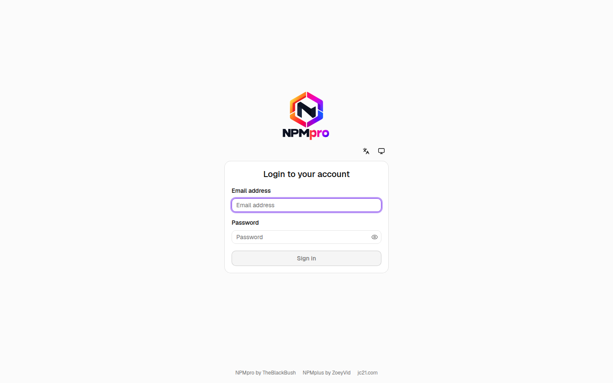
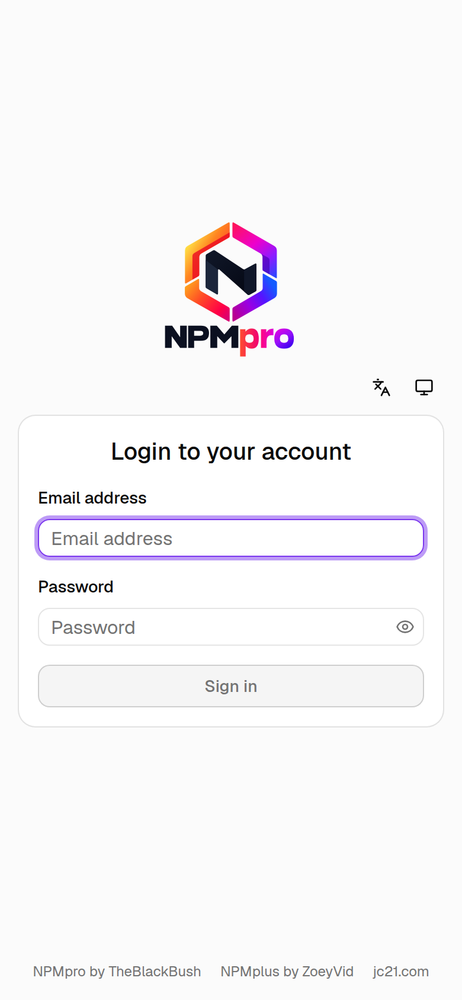

# Authentication

Signing in to the NPMpro web UI: passwords, two-factor authentication and OIDC. To put a login in front of your own services, see [Forward authentication](Forward-Authentication).

<picture>
  <source media="(prefers-color-scheme: dark)" srcset="images/login-dark.png">
  
</picture>

<picture>
  <source media="(prefers-color-scheme: dark)" srcset="images/phone-login-dark.png">
  
</picture>

## Passwords and two-factor authentication

Every user signs in with an email address and a password. Two-factor authentication (TOTP, with one-time backup codes) can be turned on for each account in the user menu (Account window, **MFA** part). When password sign-in is off (OIDC only), the **Password** part still changes the password and says that it is used again once password sign-in is turned back on. If you are locked out, the password and MFA can be reset from the command line (SQLite only): `docker exec -it npmpro password-reset.js USER_EMAIL [--disable-mfa]`, the new password is read from stdin. See [Usage](Usage#password-and-mfa-reset). The session cookie is signed with `COOKIE_SECRET`, see [Configuration](Configuration#cookie_secret).

## Password reset by mail

A user who forgot the password can set a new one from a link sent to their address. It is off by default, because whoever controls a user's mailbox can take over the account: turn it on only when you accept that risk. Under Settings, Authentication, the switch **Allow password reset by mail** (in the sign-in rules) turns it on. `PASSWORD_RESET=true` or `false` sets it from the environment and locks the switch.

It is offered only when all of these are true:
- Mail is set up under Settings, Notifications (see [Notifications](Notifications)).
- A public URL is set there (or with `PUBLIC_URL`): an `https://` address with no path, the link is built from it.
- The switch is on.
- Password sign-in is not turned off by OIDC (see [OIDC login](#oidc-login)).

Only then does the sign-in page show **Forgot password?** under the sign-in button. The page asks for an address and always answers that a mail is on its way if an account exists, so it cannot be used to find out which addresses have accounts (see [Security](Security#password-reset-by-mail)).

- The mail holds a button with a link to `/reset-password`. The one-time token is in the part of the link after `#` (the fragment), so it is not sent to the server with the page address and is not written to the logs. The link works once and for 30 minutes.
- A newer request, a password change or a used link makes an older link invalid. Only a hash of the token is stored.
- After a reset every session is signed out. Two-factor sign-in stays as it is, and API tokens keep working.
- A notice mail "Your NPMpro password was reset" goes out after every reset made with the link, with the time, the address the request came from and the number of API tokens that are still active (see [Notifications](Notifications#account-mails)). If you did not ask for the reset, sign in as an administrator, revoke the tokens and change the password.
- Every user can reset by mail, the only administrator included. A user without a password (OIDC only) and a disabled user get no mail.
- Limits: 5 requests per 15 minutes from one IP address (an IPv6 address counts per /48), across the three reset routes, and at most 3 mails per hour to one address. A request over a limit gets the same answer and no mail.
- If the mail cannot be sent, nothing else happens: the user sees the same answer and the administrator finds a line in the audit log.

When the switch is off, or the mail server or public URL is missing, the reset is not offered and the command line reset below still works, so it stays the way to recover an instance nobody can reach by mail.

## OIDC login

OIDC is set up under Settings, Authentication in the web UI (administrators only). Enter the issuer URL, client ID, client secret and redirect domain, register the shown callback URL at your provider, then enable it. The sign-in page then shows a button with the name, colour and icon you choose.
- Environment variables win: `OIDC_ISSUER_URL`, `OIDC_CLIENT_ID`, `OIDC_CLIENT_SECRET`, `OIDC_REDIRECT_DOMAIN`, `OIDC_REQUIRE_VERIFIED_EMAIL`, `OIDC_SKIP_MFA` and `OIDC_DISABLE_PASSWORD` override the saved value of their field. The field is shown as "Set by environment" and cannot be changed in the UI. If the four connection variables are all set, OIDC is active without enabling it in the UI. `OIDC_CLIENT_ID_FILE` and `OIDC_CLIENT_SECRET_FILE` read the client id and secret from files instead, see [Secrets from files](Configuration#secrets-from-files); the tooltip then names the variable without `_FILE`.
- Scopes default to `openid email profile`. A provider that only allows some scopes may need this changed (for example to `openid email`).
- Disable password login: only OIDC can then be used to sign in. This can only be turned on from a session that signed in with OIDC, and a session that signed in with a password also cannot save a change that would switch it on in effect (for example enabling OIDC while it is still set). A value set by `OIDC_DISABLE_PASSWORD` is not affected. To restore password login set `OIDC_DISABLE_PASSWORD=false` and recreate the container (`docker compose up -d`).
- Require a verified email (default on) refuses users whose provider has not verified their email address. Skip two-factor after OIDC (default off) trusts the multi-factor check of the provider.
- Create users on their first sign-in (default off): a person without an account gets one with the default permissions set on the page. Allowed email domains limit this (comma separated, empty allows any domain; they are dotted host names such as `example.com`, single-label and non-ASCII names are not accepted). Enabled users can always sign in. Warning: with an empty domain list and Require a verified email off, anyone your provider will authenticate gets an account, under any email address they can set at the provider. New users are never administrators, an access list cannot be hidden while proxy hosts are visible, and certificates cannot be hidden while any host type is visible.
- Button icon: choose a built-in icon, upload a file or download one from a URL. PNG, JPEG, WebP and SVG are accepted, up to 256 KB. SVG files that contain scripts, event handlers, embedded documents or references to other files (anything but `#` fragments and inline PNG, JPEG or WebP images) are refused.
  Built-in icons: Login, Key, Lock, Shield, User and Cloud (generic), and the logos of Authentik, Authelia, Keycloak, Okta, Auth0, OpenID, Google, GitHub, GitLab and Gitea. They are shown in the button text colour. An icon saved earlier as Windows keeps working (it shows a grid icon) but is no longer offered.
  Logo credits: the provider logos come from [Simple Icons](https://simpleicons.org) (CC0), except the following. The [Authelia logo](https://www.authelia.com/reference/guides/branding) is licensed under the [Apache License 2.0](https://www.apache.org/licenses/LICENSE-2.0). Keycloak is a trademark of The Linux Foundation, see its [trademark usage](https://www.linuxfoundation.org/legal/trademark-usage) page. All logos are trademarks of their respective owners; their use does not imply endorsement.
- Sign-in errors are shown on the sign-in page by code: `not_configured`, `provider_error`, `no_email`, `email_not_verified`, `no_user` (no account and auto-create is off), `domain_not_allowed` (email domain not in the allowed list), `user_disabled`, `identity_mismatch` (the account is linked to another identity at the provider) and `maintenance` (a database move is running, new accounts cannot be created).

### Linked identities

The first OIDC sign-in of a user links the account to the provider's identity (issuer and subject). An account created by the first sign-in is linked at once. For a user with two-factor authentication the link is made once the code is verified: a sign-in that stops at the code leaves the account unlinked, while a sign-in with a mismatching identity is refused before the code is asked for. Users who signed in with OIDC before this version link at their next OIDC sign-in.
- A later sign-in for the same email address with another identity at the same provider is refused (`identity_mismatch`, "This account is linked to another account at the sign-in provider"), and so is an identity that is already linked to another user. The refusal is in the audit log. An administrator fixes it under Settings, Users: **Unlink OIDC** in the row menu, or in the user's **Sign-in** part (Edit on the row). The next OIDC sign-in links the account again.
- Changing the provider (another issuer URL) links each user to the new provider at their next sign-in.
- Changing a user's email address keeps the link.
- The Users table has a Sign-in column: Local (the user has a password) and OIDC (linked; the tooltip shows when).
- A backup merge clears the links of the users it adds or replaces; they link again at their next OIDC sign-in.

## Scripts and AI assistants

Scripts and AI assistants do not sign in with a password or OIDC. They use an API token, sent as `Authorization: Bearer`, which keeps working with OIDC-only sign-in and with MFA. Tokens have their own expiry and can be revoked at any time. See [API tokens and MCP](API-tokens-and-MCP).
