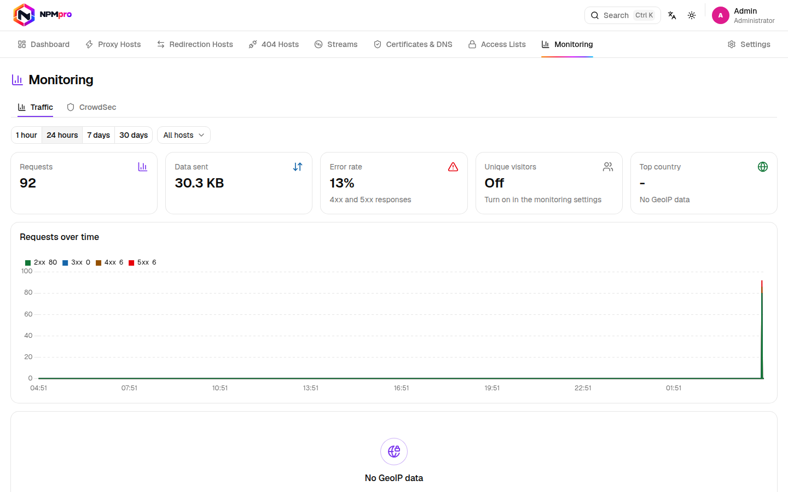

# Monitoring

Administrators get a Monitoring page in the web UI with a Traffic tab (`/monitoring/traffic`) and a CrowdSec tab (`/monitoring/crowdsec`), plus a short monitoring row on the dashboard (requests and error rate today, the active bans with the bans added in the last 24 hours and the five most common reasons, and the seven busiest countries today). It is read-only.

<picture>
  <source media="(prefers-color-scheme: dark)" srcset="images/monitoring-traffic-dark.png">
  
</picture>

- Traffic statistics are off by default. Turn them on under Settings, Logs & monitoring (`/settings/monitoring`). NPMpro then reads the nginx access log itself and counts requests, bytes sent and status classes per host. Switching the setting in the UI turns the access log on or off without a restart. With `LOGROTATE=true` or `TRAFFIC_STATS=true` the access log is already on when the container starts. Write log files (`LOGROTATE`) and GoAccess keep the access log on disk but do not turn traffic statistics on: only the setting or `TRAFFIC_STATS` does.
- Switching traffic statistics off stops reading the access log, so nothing new is stored. The stored statistics are kept until they age out (the retention period), unless you tick "Also delete the stored statistics" in the dialog that opens when you save the switch-off: then all stored counts, top lists, visitor IPs and visitor hashes are deleted before the setting is saved (if the delete fails, nothing is changed).
- The Monitoring menu entry and the monitoring row on the dashboard are only shown while there is something to show: traffic statistics are on or the CrowdSec bouncer is configured. Opening `/monitoring` otherwise shows "Monitoring is off" with a link to the settings.
- Counts are stored per minute for the last 24 hours and per hour for the whole retention period (30 days by default, adjustable from 7 to 365 days).
- Requests for names that are not one of your hosts (the default site, requests by IP, random names) are grouped as "Other hosts". Requests for hosts with a trailing wildcard (`www.example.*`) or a regex name also land there.
- NPMpro's own requests are not counted: everything nginx receives on the admin UI port (`NPM_PORT`, also behind a remapped Docker port), which includes the container health check. If `NPM_PORT` is 80 or 443, only the health check itself (from the container or `NPM_IPV4_BINDING`) is left out. The access log records the receiving port as its last field (`$server_port`).
- Countries and networks (ASN) are always counted when GeoIP databases exist. Show visitor IPs (off by default) additionally stores the top visitor IPs. Turning it off deletes all stored IPs.
- Count unique visitors (Settings, Logs & monitoring, off by default) shows how many different visitors each host has per day and for the selected range, without storing any IP. Visitors are counted per UTC day, so the range count starts at the beginning of the UTC day the range starts on (24 hours can cover two calendar days, 7 days eight). For every visitor, host and UTC day NPMpro stores only a keyed hash: HMAC-SHA256 of the visitor IP with a random key that is created once and stored encrypted in the database (it never leaves the server), cut to the first 16 bytes. An IPv4-mapped IPv6 address counts as IPv4; other IPv6 addresses count per /64 network, so one device that changes its address counts once (several users on the same /64 count as one). The hashes are kept for the traffic retention days. Turning the setting off deletes all stored hashes before the change is saved. Each visitor is counted once per host and day (IPv6 addresses per /64 network), up to the visitor limit (Settings, Logs & monitoring, 100000 by default, 1000 to 1000000); when a host reaches it on a day the count is shown with a plus sign ("100000+"). The 1 hour range shows the visitors of the current UTC day.
- Top hosts are grouped per NPMpro host (proxy, redirection or 404 host) with all its domain names. A host row links to the page filtered to that host (the URL keeps `host_type` and `host_id`). Every top list shows at most 10 rows.
- GeoIP is set up under Settings, GeoIP (`/settings/geoip`). Choose the provider first:
  - **DB-IP Lite** is the default. It needs no account: its Country and ASN databases are on by default, and NPMpro checks for a new monthly file once a week.
  - **MaxMind GeoLite2** needs a free account: enter your account ID and license key ([create them here](https://www.maxmind.com/en/geolite2/signup)) and choose the editions (`GeoLite2-Country` and `GeoLite2-ASN` by default, `GeoLite2-City` is optional). Its databases update every 3 days.
- Exactly one provider is active and only its databases are used. The active provider is `GEOIP_PROVIDER` when it is set, else the provider saved in the UI, else MaxMind when an account ID and license key are set, else DB-IP. A switch keeps the other provider's files on disk, so switching back needs no new download. The GeoLite2 EULA asks you to delete copies older than 30 days, so MaxMind users should remove files they no longer use.
- NPMpro downloads the databases itself: when the provider, the credentials or the databases are changed, when "Update now" is used, and automatically: MaxMind every 3 days, DB-IP every 7 days. A failed automatic update is retried after 24 hours. Update now needs a saved account ID and license key with MaxMind, and at least one database selected with DB-IP. A separate geoipupdate container is not needed anymore (the old container still works, but is legacy). The files are stored in `/data/goaccess/geoip`, the same place GoAccess and the [geoblocking example](Security#geoblocking) read them from. Without databases the map and the country and network lists are hidden, the rest works.
- CrowdSec bans: the CrowdSec tab shows the currently active bans (total, added in the last 24 hours, by reason (the CrowdSec scenario), origin and type, a map and the newest bans). It needs the bouncer enabled in Settings, CrowdSec (see [CrowdSec](CrowdSec)) with an API key or a TLS client certificate. NPMpro reads the bans with those settings (including Verify TLS certificates), read-only, and polls the LAPI every 60 seconds. It needs no additional key. Only active bans are shown, no alerts.
- Credits: the GeoIP credit of the active provider is shown under the traffic map, in Settings, GeoIP and in the footer. With DB-IP Lite it reads "IP Geolocation by DB-IP" under [CC BY 4.0](https://creativecommons.org/licenses/by/4.0/); with MaxMind GeoLite2 it reads "This product includes GeoLite Data created by MaxMind, available from https://www.maxmind.com."
- Map data: the country shapes of the maps come from [world-atlas](https://github.com/topojson/world-atlas) (Natural Earth, public domain) and are drawn with [react-simple-maps](https://github.com/zcreativelabs/react-simple-maps) (MIT).
- For alerts, decision management and CrowdSec metrics I recommend the companion project [CrowdSec Web UI](https://github.com/TheDuffman85/crowdsec-web-ui).
- The TLS handshake log (`/data/nginx/logs/tls.log`, setting TLS handshake log under Settings, Logs & monitoring) is for CrowdSec. Neither the traffic statistics nor GoAccess read it, see [CrowdSec](CrowdSec#tls-handshake-log).
- Environment variables win over the saved value and lock their field in the UI ("Set by environment"):
  - `TRAFFIC_STATS` (`true` or `false`); it is the only variable that sets traffic statistics (`LOGROTATE` and `GOA` do not)
  - `TRAFFIC_RETENTION_DAYS` (7 to 365, default 30; any other value stops the container from starting)
  - `TRAFFIC_SHOW_IPS` (`true` or `false`, default false)
  - `TRAFFIC_UNIQUE_VISITORS` (`true` or `false`, default false)
  - `TRAFFIC_VISITORS_CAP` (visitor limit per host and day, 1000 to 1000000, default 100000; any other value stops the container from starting)
  - `GEOIP_PROVIDER` (`dbip` or `maxmind`; it locks the provider choice)
  - `GEOIP_DBIP_EDITIONS` (DB-IP only, `Country` and `ASN` separated by a space, both on by default)
  - `GEOIP_ACCOUNT_ID`, `GEOIP_LICENSE_KEY` and `GEOIP_EDITIONS` (MaxMind only; `GEOIP_EDITIONS` is space separated, for example `GeoLite2-Country GeoLite2-ASN`; unknown edition names are ignored, and if none is valid the variable is ignored and the field stays editable)
  - `GEOIP_ACCOUNT_ID_FILE` and `GEOIP_LICENSE_KEY_FILE` read the account id and the license key from files instead, see [Secrets from files](Configuration#secrets-from-files)

## GoAccess

GoAccess builds a web log report from the access log. Turn on GoAccess report under Settings, Logs & monitoring (or set `GOA=true`); it applies after a restart of the container. The report is then served under `/goaccess` of the web UI and only reachable for signed-in administrators. GoAccess reads the log files, so it turns on `LOGROTATE` at the start: Write log files stays on while it runs (CrowdSec keeps it on too). Traffic statistics are a separate setting and stay as they are.
- GoAccess reads the log format it started with (Settings, Logs & monitoring, Log format), so restart the container after you change the format. In the JSON format GoAccess leaves empty values (referrer, user) out of its panels, where the classic format lists them as `-`. The traffic statistics of NPMpro read both formats, also in a file that changes from one to the other.
- The GoAccess options are fields in the same block, all applied after a restart: keep report data (1 to 366 days, default 30), anonymize visitor IPs (off or level 1 to 3, default level 1), drop query strings (default on), full operating system versions (default on) and resolve host names (default on, this sends DNS queries for visitor IPs). `--agent-list --double-decode` are always used.
- `GOACLA` replaces these fields with your own GoAccess options and locks them. Its default matches the default fields: `--agent-list --real-os --double-decode --anonymize-ip --anonymize-level=1 --keep-last=30 --with-output-resolver --no-query-string`.
- When GeoIP databases are in `/opt/npmpro/goaccess/geoip` (downloaded by NPMpro, see Settings, GeoIP; the files of the active provider, DB-IP or GeoLite2), GoAccess uses them automatically after a restart, unless `GOACLA` sets its own `--geoip-database`. GoAccess picks up a provider switch only at the next container start: until the new provider's download has finished and the container has restarted, GoAccess has no geo data.

## Events

NPMpro watches for problems and changes and records each one as an event. Mail alerts for these events are set up under [Notifications](Notifications#mail-alerts).

State events describe a problem that lasts. Each one is sent when it starts or changes and once more when it recovers. While it stays bad, a reminder comes every 24 hours (the interval is a setting, see [Notifications](Notifications#mail-alerts)). A restart repeats nothing. The first time NPMpro sees an object that is healthy, nothing is sent.

Disabling a host, a dynamic DNS record or a backup schedule ends its problems without a recovery message, and no reminders follow. When it is enabled again, NPMpro checks it afresh. A restore that replaces hosts, certificates, dynamic DNS records or backup schedules does the same for them: their states are checked again after the restore.

- **Certificate expiring:** a certificate is inside its warning window (see [Configuration](Configuration), `CERT_WARNING_DAYS`) or has expired.
- **Certificate renewal failed:** a renewal run ended with an error for a certificate that is due, or a due certificate expired. One run can cover several certificates, and certbot gives one error text for the whole run, so each of them shows that text.
- **Host config error:** the nginx config of a host fails the nginx test.
- **Backup failed:** a backup failed. A scheduled run that was skipped counts as failed, like its last status.
- **GeoIP update failed:** the GeoIP databases could not be downloaded.
- **CrowdSec unreachable:** the CrowdSec LAPI has been unreachable for 5 minutes.
- **Dynamic DNS record failed:** a dynamic DNS record could not be updated.
- **Dynamic DNS record stopped:** the provider stopped a dynamic DNS record. NPMpro does not try it again until you act.

Action events mark something that was done. They are sent to [webhooks](Notifications#webhooks) only, never mailed, and each happens once:

- **Host created, updated, enabled, disabled and deleted.**
- **Certificate issued, renewed and deleted.**
- **Backup succeeded** (a scheduled run) and **backup restored.**
- **Database moved** and **database move failed.** A move is reported at the first start on the new database.
